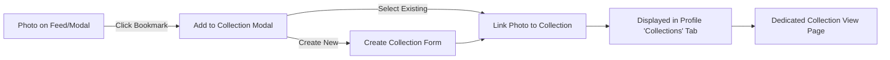
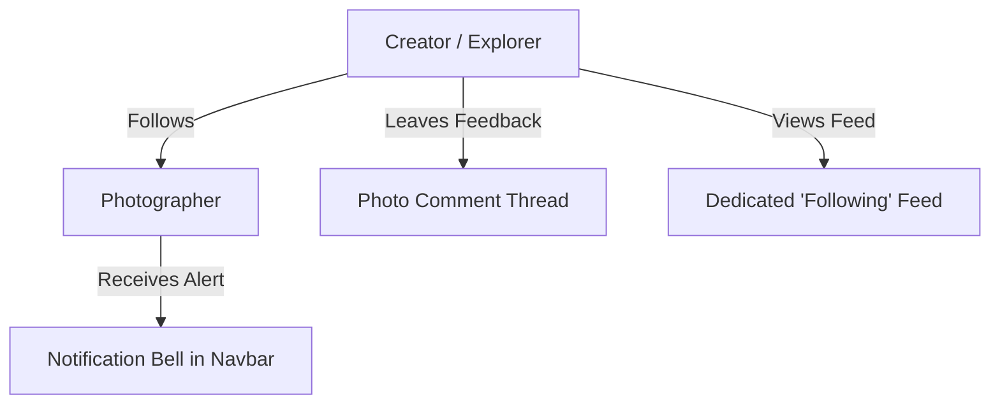

# #Hashtag — Master Product Roadmap & Implementation Plan

A comprehensive, phase-by-phase engineering roadmap to develop **#Hashtag** into a premier visual social platform and photo-sharing community (comparable to Unsplash, Pinterest, and VSCO).

---

## 📌 Status Legend
- `[x]` **Completed & Verified**
- `[/]` **In Progress**
- `[ ]` **Planned / Upcoming**

---

## 🏆 Milestone 0: Core Foundation & Platform Infrastructure (Completed)
- [x] **Modern UI Revamp**: Unsplash-style responsive multi-column Masonry Grid, semi-transparent sticky header (`backdrop-blur-md`), and sticky hashtag pill bar.
- [x] **Backend & Database Setup**: Express REST API on port `5000`, Prisma ORM with SQLite database, and CORS configuration.
- [x] **Authentication Engine**: JWT authentication (`/api/auth/register`, `/api/auth/login`), split-screen auth UI with Creator vs Explorer personas, live password strength meter, and 24-photo mosaic wall.
- [x] **Creator Upload Studio**: Drag-and-drop upload modal with live preview, hashtag tagging, camera EXIF extraction, and multipart upload to local `/uploads`.
- [x] **Admin Command Center (`/Admin`)**: Telemetry overview, real-time KPI metrics, photo moderation (Feature / Unfeature / Delete), and user role management.
- [x] **Authentic Database Telemetry**:
  - [x] Wiped artificial mock seed numbers.
  - [x] Real database-persisted **Likes** (`Like` table) with instant toggle and user association.
  - [x] Real database-persisted **Downloads** (`Download` table) with resolution tagging (`small`, `medium`, `original`).
  - [x] Real **Views** tracking with session `useRef` guard (infinite loop eliminated).
- [x] **User Profile System (`/profile/:username` & `/profile`)**:
  - [x] Cover banner backdrop, customizable avatar, role pills (`Super Admin`, `Verified Creator`, `Explorer`).
  - [x] Real performance cards (Uploaded count, Total views, Total downloads, Total likes).
  - [x] Two tabs: Uploaded Photos grid (with owner delete controls) and Favorited/Liked Photos grid.
  - [x] Edit Profile modal (display name, avatar URL, bio).

---

## 🚀 Milestone 1: Custom Collections & Moodboards ("Save to Folder")
*Goal: Allow users to organize photos into themed collections (Pinterest / Unsplash style).*



### Tasks:
- [x] **Database Schema**:
  - [x] Add `Collection` model (`id`, `userId`, `title`, `description`, `isPrivate`, `createdAt`, `updatedAt`).
  - [x] Add `CollectionPhoto` join model (`collectionId`, `photoId`, `addedAt`).
  - [x] Run Prisma migration / sync (`prisma db push` & `seed.js`).
- [x] **Backend Endpoints (`server/src/routes/collections.js`)**:
  - [x] `GET /api/collections` (fetch public collections with previews).
  - [x] `GET /api/collections/:id` (fetch single collection with photos).
  - [x] `POST /api/collections` (create collection).
  - [x] `POST /api/collections/:id/photos` (add photo to collection).
  - [x] `DELETE /api/collections/:id/photos/:photoId` (remove photo from collection).
  - [x] `DELETE /api/collections/:id` (delete entire collection).
  - [x] `GET /api/collections/my/status` (query saved status for quick modal toggling).
  - [x] `GET /api/collections/user/:username` (fetch user profile moodboards).
- [x] **Frontend Components**:
  - [x] Build `AddToCollectionModal.js` (triggered by bookmark button on cards and in `PhotoModal`).
  - [x] Add a **"Collections"** tab to `ProfilePage.js` with collage cards and "+ New Collection" creator.
  - [x] Build `CollectionDetailPage.js` (`/collections/:id`) with collection banner, curator profile, and photo masonry grid.
  - [x] Build `CollectionsExplorePage.js` (`/collections`) to discover community moodboards.
  - [x] Added "Collections" navigation link to Navbar and mobile drawer.

---

## 🔍 Milestone 2: Pro Filters, Smart Sorting & Color Discovery
*Goal: Enhance discovery for designers, developers, and photo enthusiasts.*

### Tasks:
- [ ] **Orientation Filters**:
  - Filter by `All`, `Landscape (16:9)`, `Portrait (9:16)`, `Square (1:1)` in `HashtagBar.js`.
- [ ] **Smart Sorting Dropdown**:
  - Sort by: `Trending` (high likes in recent days), `Most Liked`, `Most Downloaded`, `Most Viewed`, and `Newest`.
- [ ] **Color Discovery**:
  - Color picker swatch pill bar (Red, Green, Blue, Dark/Monochrome, Warm, Pastel).
  - Filter photos matching dominant color palettes.
- [ ] **Related Photos Engine**:
  - Display a "More Like This" section at the bottom of `PhotoModal.js` matching tags and visual style.

---

## 👥 Milestone 3: Social Graph & Community Interaction
*Goal: Deepen community connection between creators and visual explorers.*



### Tasks:
- [ ] **Follow System**:
  - `Follow` model in SQLite (`followerId`, `followingId`, `createdAt`).
  - Endpoints: `POST /api/users/:id/follow`, `GET /api/users/:id/followers`.
  - Connect the "Follow Creator" button on `ProfilePage.js` to live database records.
- [ ] **Dedicated "Following Feed"**:
  - Homepage tab switcher: `Explore (Global)` vs `Following (My Network)`.
- [ ] **Comments & Gear Discussions**:
  - `Comment` model (`id`, `photoId`, `userId`, `content`, `createdAt`).
  - Comment thread component under photo details in `PhotoModal.js`.
- [ ] **Live Notification Center**:
  - Notification bell icon in `Navbar.js` with dropdown alerts for likes, downloads, and follows.

---

## 💼 Milestone 4: Creator Economy & Lead Generation
*Goal: Provide tangible incentives and income opportunities for photographers.*

### Tasks:
- [ ] **"Hire Photographer" Booking Modal**:
  - Clean booking request modal on creator profiles with shoot date, location, project type, and budget.
  - Generates direct lead notifications for the creator.
- [ ] **Creator Tip Jar ("Buy Me a Coffee")**:
  - Optional creator donation link (BuyMeACoffee, Stripe, PayPal) displayed on profile and photo download screens.
- [ ] **Creator Analytics Studio**:
  - Private insights dashboard for photographers: 30-day views graph, top downloaded photos, and geographic reach.

---

## 🛠️ Milestone 5: Media Pipeline & Storage Optimization
*Goal: Transition from local disk storage to production cloud infrastructure.*

### Tasks:
- [ ] **Cloud Media Integration**:
  - Integrate Cloudinary or AWS S3 / Supabase Storage for permanent cloud CDN media delivery.
  - Auto-generate WebP variants (`thumbnail ~400px`, `display ~1920px`, `original`).
- [ ] **In-Browser Social & Wallpaper Cropper**:
  - Allow users to download pre-cropped formats: `Original`, `iPhone Wallpaper (9:16)`, `Twitter Banner (3:1)`, or `Square (1:1)`.

---

## 🌐 Milestone 6: Production Hardening & Cloud Deployment
*Goal: Ship the production build with enterprise security and high availability.*

### Tasks:
- [ ] **Security & OAuth**:
  - 1-click Google / GitHub OAuth login.
  - Rate limiting on API routes and secure HTTP headers (Helmet).
- [ ] **Production Build**:
  - Configure production environment variables (`.env.production`).
  - Frontend deployment pipeline (Vercel / Netlify).
  - Backend and database deployment (Render / Railway / Fly.io).

---

## 📅 Recommended Immediate Next Sprints

```
Sprint 1: Collections & Moodboards (Milestone 1)
   ├── Step 1.1: Database schema & Prisma migration for Collections
   ├── Step 1.2: Backend REST endpoints (/api/collections)
   ├── Step 1.3: "Add to Collection" modal in UI
   └── Step 1.4: Collections tab on Profile and Collection View page

Sprint 2: Pro Filters & Smart Sorting (Milestone 2)
   ├── Step 2.1: Orientation & sorting dropdowns on Navbar
   └── Step 2.2: "More Like This" recommendations in PhotoModal
```
